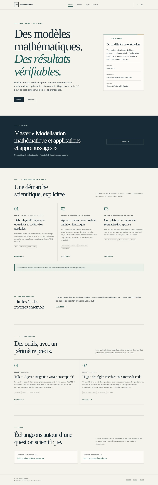

# Portfolio review / Revue du portfolio

Version complète anglais/français préparée dans le cloud. Les captures ci-dessous proviennent de Chromium, à 1440 px sur ordinateur et 390 px sur mobile. Elles montrent les pages servies par HTTP, avec leurs figures chargées.

Complete English/French version prepared in the cloud. Screenshots below were captured from HTTP-served pages in Chromium at 1440 px desktop and 390 px mobile, with scientific figures loaded.

## Captures / Screenshots

| English | Français |
| --- | --- |
| [Home — desktop](home-en-desktop.webp) | [Accueil — ordinateur](home-fr-desktop.webp) |
| [Home — mobile](home-en-mobile.webp) | [Accueil — mobile](home-fr-mobile.webp) |

- [Projects — desktop](projects-en-desktop.webp)
- [Projet EDP — mobile](pde-fr-mobile.webp)
- [Neural approximation — desktop](nn-en-desktop.webp)
- [Synthèse inverse — ordinateur](synthesis-fr-desktop.webp)

## Validation

- 20 routes de contenu EN/FR, 510 références internes, métadonnées, hreflang, JSON-LD et sitemap : conformes.
- Nu HTML Checker 26.10.11 : 22 documents HTML valides, pages 404 comprises.
- Chromium 154.0.8037.57 : 80 vérifications page/largeur (320, 390, 768, 1440 px), sans débordement, erreur JavaScript ou ressource défectueuse.
- axe-core 4.10.3 : 40 audits WCAG 2 A/AA, aucune violation détectée. Les captions de tableaux défilants signalées pour inspection complémentaire ont un contraste calculé de 5,185:1.
- Navigation au clavier, menu/Escape, lien d’évitement, tableaux défilants, changement de langue avec paramètres/ancre, navigation sans JavaScript et réduction des animations : vérifiés.
- Sources scientifiques : branches pertinentes inspectées, valeurs/attributions/limites conservées, expériences non relancées, dépôts scientifiques inchangés.
- 100 liens externes HTTP 200 ; ORCID bloqué par le proxy cloud, sans constat de lien cassé. 94 cibles Git immuables et trois ancres Markdown validées.

## Performance locale / Local laboratory performance

Médianes de trois contextes Chromium neufs, largeur 390 px, CPU ralenti 4×, latence 150 ms, téléchargement 1,6 Mbit/s. Il s’agit de mesures de laboratoire sur serveur local, et non de données utilisateurs réelles ou d’un score Lighthouse. Le transfert initial exclut les figures hors écran chargées à la demande.

| Page | LCP médian | CLS médian | Transfert initial |
| --- | --- | --- | --- |
| / | 712 ms | 0.000 | 44,644 B |
| /fr/ | 676 ms | 0.000 | 45,010 B |
| /projects/pde-image-denoising/ | 676 ms | 0.000 | 49,080 B |

Four initial requests per sampled route. Shared CSS is 29.3 KB before compression; JavaScript is 2.2 KB. Production performance depends on GitHub Pages delivery and the client device/network.

Le workflow `Portfolio checks` conserve une archive statique `portfolio-preview` pour la revue. Il ne déploie pas le site. Les rapports détaillés et captures supplémentaires sont conservés hors du site publié ; ce dossier est exclu de GitHub Pages.

Fusion et mise en ligne attendent la validation du propriétaire.
