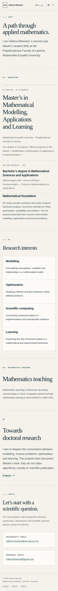
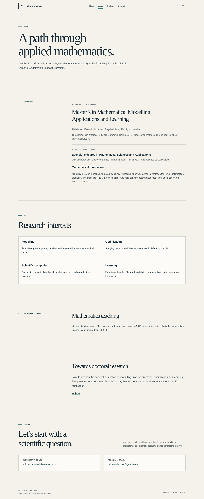

# English education translation

The English education headings and institution names are translated. Official French diploma titles remain secondary references with French language tags, and M2 remains in progress.

Chromium review passed for home/About in both languages at 320, 390 and 1440 px: 12 page/viewport cases and 12 language switches preserving the route, query and fragment. No overflow, missing resources or browser errors were found.

## About — mobile (390 px)

## About — desktop (1440 px)

Review images are excluded from the published GitHub Pages site.
