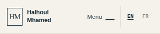
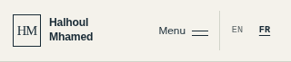
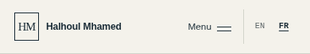

# Header translation protection

Only the `HM` monogram and the header name have `translate="no"` and `notranslate`. Page content and English/French navigation remain translatable.

The badge retains its dimensions, with centred text, no flex shrinking and no line wrapping. The name may wrap on very narrow screens to preserve room for the menu and language selector.

Chromium checks passed 12 normal English/French header cases at 280, 320, 360, 390, 768 and 1440 px, 12 language switches preserving route/query/fragment and 24 DOM wrapper simulations. No overflow or overlap; maximum measured monogram centring error: 0.008 px horizontally and 0.797 px vertically. The identity spans expose `translate=false`; main and navigation remain `translate=true`.

## English — 320 px

## French — 320 px

## English — 390 px

## French — 390 px

These are normal browser captures. DOM wrapper simulations are layout checks, not a test of a real automatic translation service. Review images are excluded from GitHub Pages.
