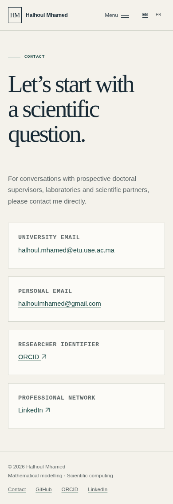
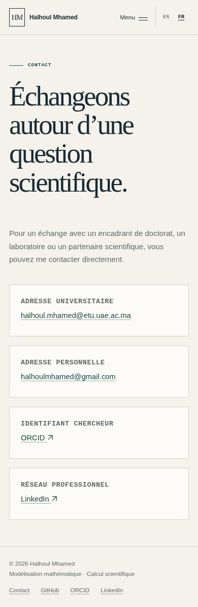
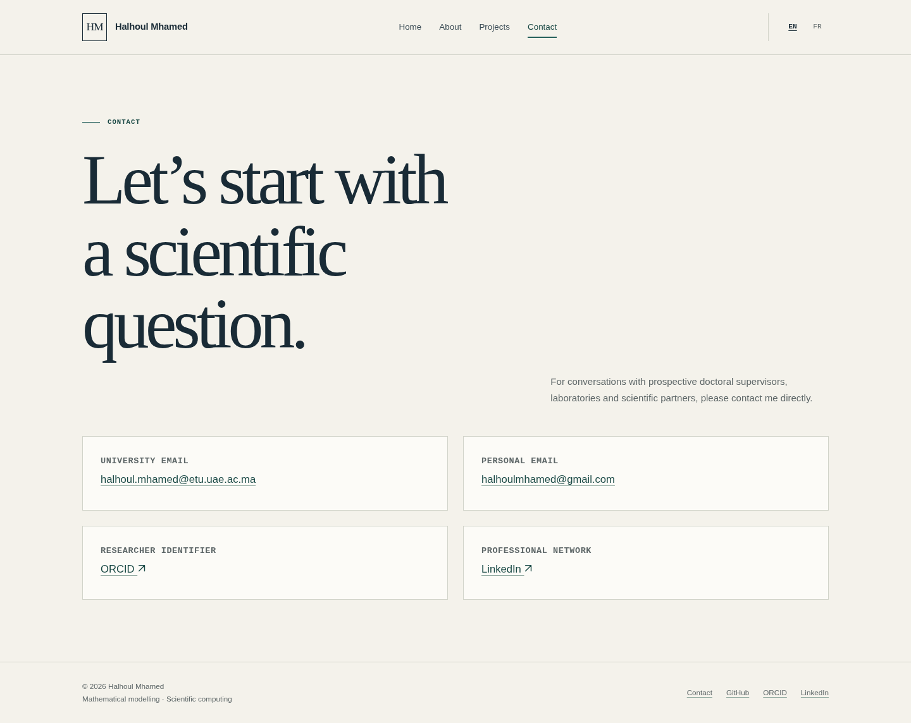
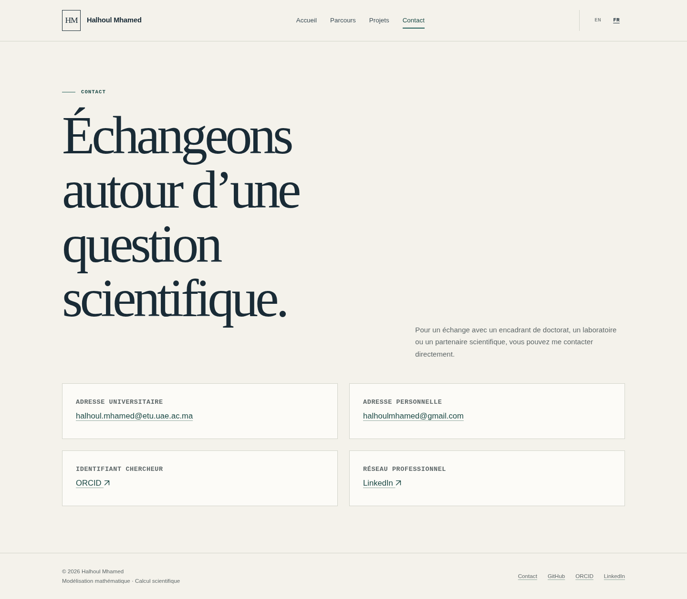

# Professional profile links

ORCID and LinkedIn appear in Contact and the footer in both languages. The existing typography, colours and arrow icon are reused; GitHub and both email addresses are preserved.

Targeted browser review passed 18 page/viewport cases at 320, 390 and 1440 px, 90 Tab/Enter link activations, 18 page-preserving language switches and both Contact pages without JavaScript. Minimum measured text and focus contrast: 5.18:1. No overflow or browser/resource errors. External keyboard activations were intercepted to check the exact destinations; access to the profile websites is not claimed.

## English — mobile (390 px)

## French — mobile (390 px)

## English — desktop (1440 px)

## French — desktop (1440 px)

Review images are excluded from the published GitHub Pages site.
